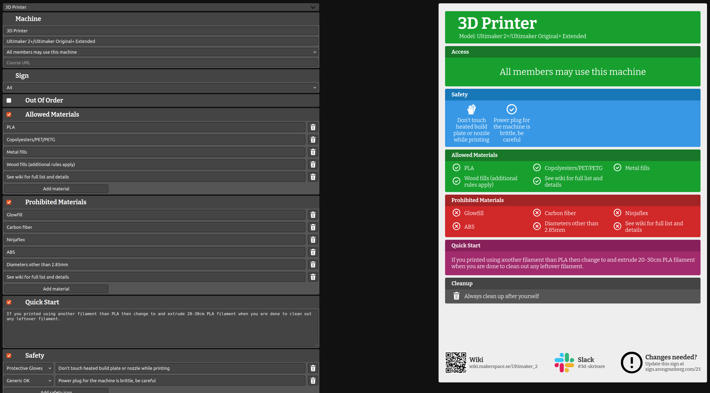

# Makerspace Machine Sign Generator

Tool for making machine signs for makerspaces.

Developed by [Stockholm Makerspace](https://makerspace.se).



## Dependencies

```text
node
npm
poetry
python3
```

## Usage

For now, just run

```bash
# Install dependencies
make install
# Build and run in dev mode
make dev

# Or in release mode
make run
```

Open [http://localhost:8000/] in a web browser
